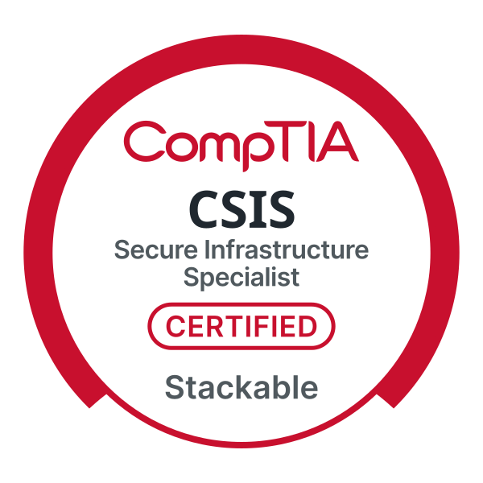

## About

Security+ certified IT professional (CSIS) with cybersecurity training through BCR Cyber's ICE-T program. I have a background in technical troubleshooting, risk and fraud analysis, and data protection. I'm seeking an entry-level role in security operations, IT support, or network and systems administration.

Waldorf, Maryland | [Jaadir2.peyton@gmail.com](mailto:Jaadir2.peyton@gmail.com) | [LinkedIn](https://www.linkedin.com/in/jaadirpeyton){:target="_blank" rel="noopener"} | [Download my resume (PDF)](Jaadir_Peyton_Resume.pdf)

## Certifications

Select a certification to open its verification page.

- **[BCR Cyber SOC Operations Analyst I (SOCOA I)](https://www.credential.net/265fdca5-2a5c-4178-8c45-0c45cce4eff9#acc.Ah4jULRa){:target="_blank" rel="noopener"}**, Oct. 2026
- **CompTIA CSIS** (Secure Infrastructure Specialist), Oct. 2026
- **[CompTIA Security+ (SY0-701)](https://cp.certmetrics.com/comptia/en/public/verify/credential/437c09aea0ce4662879b02f4b3d9f19d){:target="_blank" rel="noopener"}**, Oct. 2026 to Oct. 2029
- **[CompTIA Network+](https://cp.certmetrics.com/comptia/en/public/verify/credential/193097ca17ac491eb2a5de4d2a29c9fe){:target="_blank" rel="noopener"}**, Aug. 2026 to Oct. 2029
- **[CompTIA A+](https://cp.certmetrics.com/comptia/en/public/verify/credential/647ed63dfa574f238fbaa2ef9d3d824d){:target="_blank" rel="noopener"}**, Jul. 2026 to Oct. 2029

## Skills

- **Security and compliance:** cybersecurity, anti-fraud and risk mitigation, incident response and root cause analysis, data protection, KYC and AML compliance, compliance reporting and audits
- **Systems and administration:** system and network administration, IT troubleshooting, cloud computing and server administration, virtualization, Microsoft Office, Zendesk, ServiceNow, technical writing, remote support
- **Certified knowledge areas:** PC hardware and operating systems, TCP/IP and network troubleshooting, network security, threat and vulnerability management, security operations, identity and access management

## Experience

### Risk Mitigation Specialist, Digital Gaming Corp (McLean, VA)
March 2024 to July 2024

- Monitored player transactions, detected irregularities, and implemented anti-fraud measures to protect platform integrity and ensure compliance with gambling regulations.
- Conducted risk analysis, developed mitigation strategies, and reported risk levels to senior management, ensuring adherence to KYC and AML protocols.
- Responded to security breaches, performed root cause analysis, and implemented corrective measures to maintain system security, data protection, and compliance.

### Data Entry Specialist, Capgemini (El Paso, TX)
October 2021 to December 2023

- Entered, verified, and updated client database information, ensuring accuracy, completeness, and data integrity.
- Conducted regular audits to identify and correct discrepancies, maintaining seamless data flow across departments.
- Used virtualization and Office tools for efficient data entry while safeguarding the confidentiality and security of sensitive information.

### Additional experience

- Shift Supervisor, CVS Pharmacy, Waldorf, MD (March 2025 to present)
- Receiver, Safeway, Alexandria, VA (November 2020 to June 2021)
- Team Captain, MarketSource, Merrifield, VA (January 2020 to October 2020)
- Store Manager, Military Mobile, Joint Base Andrews, MD (August 2015 to October 2017)

## Projects

Hands-on lab write-ups and security projects are coming soon.

<!--
When you're ready, replace the line above with entries like this:

### Project name
What you built or investigated, the tools you used, and what you found.

-->

## Education

- **BCR Cyber**, Intrusion Countermeasures Education and Training (ICE-T), currently enrolled
- **Mount Vernon High School**, High School Diploma, June 2015. Awards in JROTC, Cyber Security, and Technical Theatre.
